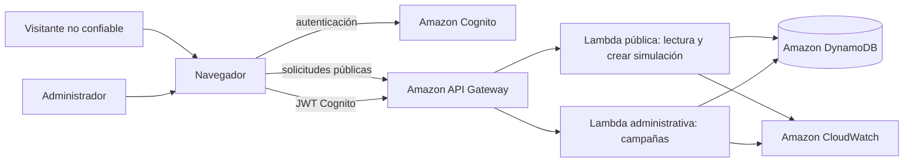

# Modelo de amenazas y pruebas de seguridad del MVP

**Estado:** borrador de diseño para el prototipo académico  
**Base:** [Requisitos del MVP](./01-requisitos-mvp.md) y [Arquitectura propuesta AWS Zero Trust](./02-arquitectura-propuesta-aws-zero-trust.md)  
**Alcance:** datos ficticios y donaciones simuladas; no pasarela, dinero ni datos de tarjeta.

## 1. Activos que proteger

| Activo | Riesgo si se compromete |
|---|---|
| Cuenta administrativa y sesiones Cognito | Un atacante podría cambiar campañas y manipular resultados de demostración. |
| Integridad de campañas | Cambios no autorizados podrían mostrar información falsa o retirar campañas. |
| Integridad de donaciones simuladas | Estados o montos manipulados invalidarían la demostración y los reportes. |
| Preferencia de publicación | Un nombre o monto podría aparecer públicamente sin autorización. |
| Datos ficticios de prueba | La exposición podría revelar datos personales si se usan accidentalmente datos reales. |
| Roles IAM, funciones Lambda y recursos AWS | Permisos excesivos podrían facilitar lectura, alteración o eliminación de datos. |
| Logs, métricas y auditoría | Registros incompletos dificultarían investigar acciones; registros excesivos podrían exponer información y aumentar costo. |
| Claridad de la demo | Un usuario podría creer que hubo un cobro real cuando solo se simuló. |

## 2. Componentes y límites de confianza

El navegador y toda entrada de usuario son no confiables. Cognito autentica al administrador, pero no sustituye la autorización de negocio. API Gateway valida el token en rutas protegidas y cada Lambda vuelve a validar el permiso requerido y el estado del recurso. Los roles de ejecución de Lambda limitan el acceso a AWS; no se usan credenciales AWS en el navegador.

## 3. Flujo y máquina de estados de donación simulada

El diseño propuesto permite al visitante completar el recorrido sin que este pueda declarar por sí mismo el resultado:

1. El visitante envía campaña, monto y preferencia de publicación.
2. La Lambda pública valida los valores y crea una operación `simulation=true`.
3. El servidor aplica una regla fija de demostración y asigna `SIMULATED_SUCCESS`; el cliente no proporciona estado ni resultado.
4. El backend persiste la operación y la marca como simulada; el total público, si existe, suma solo registros de prueba con ese estado.
5. No se permite cambiar monto, campaña o consentimiento tras crear la operación. Reintentos técnicos no deben duplicar el efecto.
6. La UI presenta un aviso claro antes y después: es una demostración, no un pago, cargo o liquidación real.

Si el profesor solicita mostrar un resultado fallido, se añadirá como una regla de simulación controlada por servidor, no como un estado elegido libremente por el navegador.

## 4. Amenazas priorizadas

| ID | Amenaza y escenario | Impacto | Controles de diseño | Prueba principal |
|---|---|---|---|---|
| T01 | Visitante modifica monto, campaña, preferencia o estado en la solicitud | Registro de prueba inválido; exposición pública no consentida | Validación de esquema y límites en backend; lista permitida de campos; estado y marca de simulación asignados exclusivamente por servidor | P01, P02 |
| T02 | Usuario no autorizado intenta ejecutar una operación administrativa | Cambios no autorizados a campañas | Cognito JWT authorizer en rutas protegidas; MFA para administradores; autorización backend por acción/recurso; rechazo por defecto | P03, P04 |
| T03 | Endpoint público expone campos internos o permite consultar una donación privada usando un identificador | Exposición de datos del donante o estado interno | No crear rutas públicas de detalle de donación; respuestas públicas por lista permitida; autorización en cada recurso protegido | P05 |
| T04 | Reenvío/repetición de la misma solicitud de donación | Duplicación de registros simulados o totales inconsistentes | Clave de idempotencia y escritura condicional cuando sean necesarias para el flujo; validar la creación en el servidor | P06 |
| T05 | Robo o abuso de cuenta administrativa | Cambios maliciosos difíciles de atribuir | MFA, cuentas individuales, sesiones revocables, permisos mínimos, registro de actor y revisión de eventos privilegiados | P03, P07 |
| T06 | Inyección de contenido en título/descripción de campaña | Ejecución de contenido o engaño a visitantes | Validación de longitud/tipo, renderizado con escape contextual, no insertar HTML sin sanitización robusta | P08 |
| T07 | Falla de función con rol IAM sobredimensionado | Lectura o modificación de datos fuera de necesidad | Rol IAM específico por función y tabla/recurso; evitar `*` cuando sea posible; separar lectura, escritura y auditoría | P09 |
| T08 | Logs guardan JWT, correo u otros datos innecesarios | Exposición de datos y aumento de impacto/costo | Logging estructurado mínimo, redacción de campos, no registrar encabezados de autorización ni payload completo, acceso y retención limitados | P10 |
| T09 | Eventos de seguridad no generan señal accionable | Ataque o error pasa inadvertido | Métricas/umbrales para fallos de autorización, errores de servidor y cambios administrativos; definir responsable y acción | P11 |
| T10 | UI da a entender que se recibió dinero | Donante/evaluador confunde simulación con un pago | Aviso persistente antes y después; estados con prefijo “simulado”; ausencia de recibos de pago real | P12 |
| T11 | Fuga de secretos AWS en código o frontend | Acceso no autorizado a recursos del entorno | Roles de ejecución y credenciales administradas; ningún secreto en bundle; revisión de repositorio y configuración | P13 |
| T12 | Abuso automatizado del endpoint público de simulación | Consumo de presupuesto AWS y ruido de logs | Límites de tasa acordes al demo, validación temprana, cuotas/presupuestos, alarmas de volumen | P14 |

## 5. Pruebas de aceptación de seguridad

Ejecutar en entorno de desarrollo/pruebas con datos ficticios y sin credenciales de producción.

| ID | Preparación y acción | Resultado esperado |
|---|---|---|
| P01 | Enviar una solicitud de donación con monto ausente, negativo, cero, no numérico o superior al límite elegido | Backend rechaza la solicitud; no crea una donación exitosa ni cambia métricas de éxito. |
| P02 | Enviar campos no permitidos como `status=SIMULATED_FAILURE`, `simulation=false`, campaña/beneficiario arbitrarios o preferencia de publicación no reconocida | Campos ignorados o solicitud rechazada; el servidor establece `simulation=true` y el resultado fijo; evento de rechazo sin datos sensibles. |
| P03 | Llamar a una ruta administrativa sin token, con token malformado o expirado | Acceso denegado; no hay mutación; señal de fallo registrada. |
| P04 | Llamar a rutas administrativas de campaña desde una sesión pública o sin token | Acceso denegado y datos sin cambios. |
| P05 | Intentar consultar detalles de una donación privada mediante su identificador desde una sesión pública | No se expone el detalle privado; la API devuelve denegación/no encontrado o solo los campos explícitamente públicos y consentidos. |
| P06 | Reintentar una misma solicitud de creación tras simular una falla de red, incluso si la campaña se archivó después del primer intento | La clave UUID v4 y la huella de solicitud devuelven el mismo registro sin duplicarlo; reutilizar la clave con otro contenido se rechaza. |
| P07 | Autenticarse como administrador sin completar MFA cuando MFA sea obligatorio | No se obtiene acceso al panel/rutas protegidas. Si la cuenta AWS del curso impide MFA, documentar la limitación y no afirmar que se probó. |
| P08 | Crear campaña con etiquetas/script en el título o descripción y visualizarla | El contenido se muestra como texto inerte; no ejecuta scripts ni altera la página. |
| P09 | Revisar políticas IAM desplegadas para cada Lambda | Cada rol solo accede a recursos y acciones requeridas; no hay permisos administrativos amplios innecesarios. |
| P10 | Generar logs con errores y acciones protegidas; buscar tokens, secretos, correos completos y payloads | No aparecen secretos ni datos personales innecesarios; logs contienen identificadores correlacionables mínimos. |
| P11 | Generar varios rechazos/cambios administrativos de prueba | La alarma actualmente configurada detecta respuestas 5xx de API; los rechazos de validación/autorización y cambios administrativos aún requieren métricas/umbrales adicionales antes de afirmar que se monitorean. |
| P12 | Completar el recorrido de donación desde la UI | En cada paso se comunica que es simulación; no hay texto que prometa cobro, recibo fiscal o recepción de dinero real. |
| P13 | Revisar bundle frontend, variables de entorno públicas y repositorio | No hay claves AWS, secretos ni credenciales de usuario/proveedor. |
| P14 | Generar un volumen de solicitudes de prueba dentro de límites acordados | API Gateway aplica un límite global de etapa (10 solicitudes por segundo, ráfaga de 20); no hay cuota por usuario/IP ni alarma específica de tasa. Medir su comportamiento en AWS y documentar los límites de presupuesto. |

## 6. Evidencia que debe guardar el equipo

El código incluye pruebas locales de validación de entradas y de propiedades de la plantilla CDK (Cognito/MFA, privacidad del bucket, rutas JWT y tablas). Estas pruebas no autentican usuarios ni ejercitan DynamoDB, API Gateway o CloudWatch desplegados. Los controles que dependan de servicios AWS solo se consideran demostrados después de una prueba autorizada en esa cuenta y región.

- Resultado de cada prueba: aprobada, fallida o no ejecutada, con fecha, entorno y evidencia sin secretos.
- Configuración relevante de authorizers, MFA, roles IAM, tablas y alarmas (sin copiar credenciales).
- Capturas de la UI mostrando el aviso de simulación y el consentimiento de publicación desactivado por defecto.
- Ejemplos de logs redactados que muestren una operación permitida, un rechazo de autorización y una transición auditada.
- Limitaciones y pruebas no realizadas, sin describirlas como controles implementados.
- Componentes asistidos por IA: propósito, cambios realizados por el equipo, verificación y limitaciones conocidas.

## 7. Decisiones que el equipo debe cerrar

1. Confirmar que el flujo exitoso simulado es automático del lado servidor y si el curso exige también un estado fallido.
2. Definir los montos mínimo/máximo y el conjunto de datos ficticios de campaña/donante.
3. Definir formato, regla y retención de auditoría/logs acorde al alcance académico.
4. Acordar umbrales de monitoreo y un presupuesto máximo de AWS antes de desplegar.
5. Confirmar si el profesor exige pruebas, capturas, diagrama formal o formato específico de informe.

## 8. Criterio de salida para comenzar implementación

El equipo puede comenzar el prototipo cuando acuerde las decisiones anteriores, el MVP se mantenga sin pagos reales y exista una cuenta/entorno AWS autorizado con límite de gasto. Implementar primero autenticación y autorización de administrador, luego campañas, después donaciones simuladas y por último monitoreo y evidencia.
